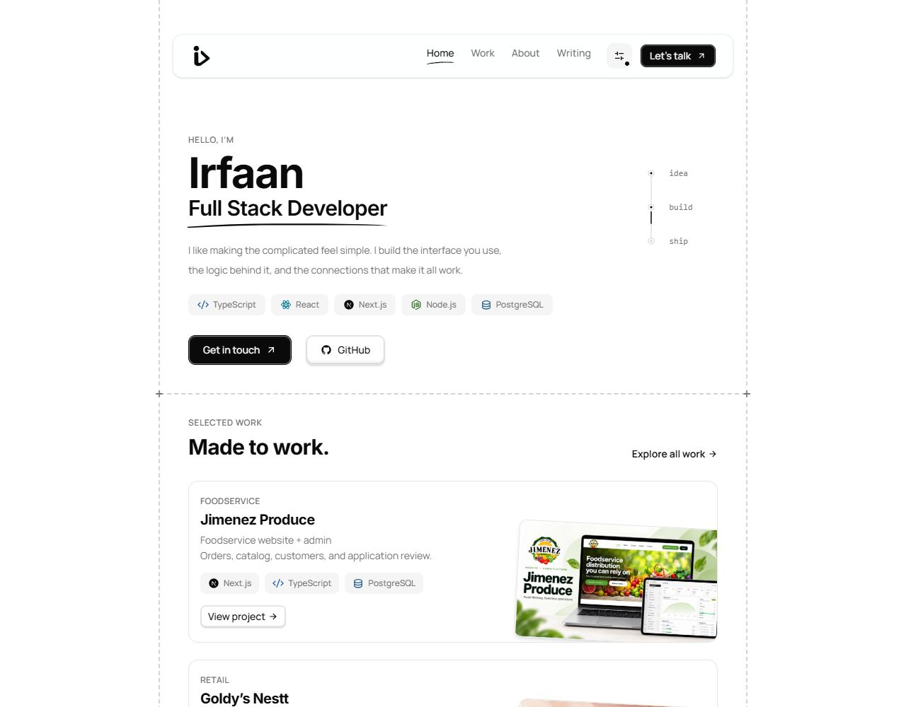

# Irfaan · Full Stack Developer

A personal portfolio for the websites, web applications, and connected systems I build. Designed around clear typography, practical work, and a simple browsing experience.

**[Visit the live site →](https://irfaan.vercel.app/)** · [Work](https://irfaan.vercel.app/work) · [Writing](https://irfaan.vercel.app/writings) · [Contact](https://irfaan.vercel.app/contact)

## Preview

<a href="https://irfaan.vercel.app/">
  <picture>
    <source media="(prefers-color-scheme: dark)" srcset="docs/images/homepage-dark.png">
    <source media="(prefers-color-scheme: light)" srcset="docs/images/homepage-light.png">
    
  </picture>
</a>

Screenshots of the deployed homepage. The preview follows your light or dark appearance.

## What’s inside

- **Selected work:** project previews, technology stacks, and individual case study pages.
- **About and capabilities:** an introduction, working approach, and services.
- **Writing:** Markdown articles with tags, read times, featured entries, and draft support.
- **Appearance controls:** light, dark, and system themes with ten accent choices and saved preferences.
- **Responsive navigation:** desktop links, mobile popovers, and active section highlighting.
- **Contact:** a validated project enquiry form that opens a prefilled email draft.
- **Shared design system:** reusable buttons, cards, badges, FAQs, and a custom SVG mark.

## Stack

| Layer | Technology |
| --- | --- |
| Application and routing | TanStack Start, TanStack Router, React, TypeScript |
| Styling | Tailwind CSS v4, CSS theme variables |
| Components | shadcn/ui, Base UI, Remix Icon |
| Forms | TanStack Form, Zod |
| Articles | Markdown, react-markdown, remark-gfm |
| Motion | Motion and CSS, with reduced-motion support |
| Build and hosting | Vite, Nitro, Vercel |

## Run locally

Use **Node.js 24** and **pnpm**.

```sh
git clone https://github.com/irfaan-ansari/irfaan.dev.git
cd irfaan.dev
pnpm install
pnpm dev
```

Open [localhost:3000](http://localhost:3000).

To preview on a phone connected to the same Wi-Fi:

```sh
pnpm dev --host 0.0.0.0
```

Open the network URL printed by Vite on your phone.

### Useful commands

| Command | Purpose |
| --- | --- |
| `pnpm dev` | Start the development server |
| `pnpm typecheck` | Check TypeScript types |
| `pnpm build` | Create the production build |
| `pnpm preview` | Preview the production build |
| `pnpm generate-routes` | Regenerate the TanStack route tree |

## Make it yours

| Content | Location |
| --- | --- |
| Name, role, email, technologies | `src/content/profile.ts` |
| Header navigation | `src/features/navigation/content/navigation.ts` |
| Footer navigation and social links | `src/content/navigation.ts` |
| About copy and working approach | `src/features/home/components/about-section.tsx` |
| Services and FAQs | `src/features/home/content/home.ts` |
| Work entries | `src/features/projects/content/projects.ts` |
| Project thumbnails | `public/projects/` |
| Articles | `src/features/writings/content/` |
| Contact fields and options | `src/features/contact/content/contact.ts` |
| Theme colors and button shadows | `src/styles.css` |
| Theme options and constants | `src/lib/theme.ts` |
| Logo, favicon, and sharing image | `public/` |

### Add work

Add an entry to `src/features/projects/content/projects.ts` and its thumbnail to `public/projects/`. The entry’s `id` becomes its URL at `/work/<id>`. The first three entries appear on the homepage.

The listing lives at `/work`. Older `/projects` and `/projects/<slug>` URLs redirect to their corresponding work pages.

### Publish an article

Create a Markdown file in `src/features/writings/content/`. Its filename becomes the slug at `/writings/<slug>`.

```markdown
---
title: A useful article title
description: A short summary for readers and search engines.
date: "2026-10-24"
tags:
  - Development
featured: false
draft: false
---

Your introduction.

## A section

Your article content.
```

Title, description, and a quoted `YYYY-MM-DD` date are required. Tags, `featured`, and `draft` are optional. Featured articles sort first, followed by publication date. Drafts are excluded from the listing and article routes. Rebuild after adding or editing articles.

### Contact form

The form validates the visitor’s name, email, project type, and message. Submission opens a prefilled email draft for them to review and send, with a copy-message fallback. It does not send or store messages on a server.

## Project structure

```text
src/
  components/
    layout/        Shared header, footer, and page frame
    shared/        Logo, icons, highlights, technology badges
    ui/            Reusable UI primitives
  content/         Shared profile and footer content
  features/
    home/          Hero, About, capabilities, and FAQs
    projects/      Work content, cards, and detail pages
    writings/      Markdown content, listings, and article rendering
    contact/       Form, validation, and email draft helpers
    navigation/    Desktop/mobile menus and active link state
  hooks/           Theme, scrolling, and viewport hooks
  lib/             Theme constants and utilities
  routes/          Route definitions, loaders, and page metadata
  styles.css       Theme tokens and global styles
public/            Static branding assets and project thumbnails
docs/images/       README screenshots
```

## Deploy on Vercel

The live site is hosted at **[irfaan.vercel.app](https://irfaan.vercel.app/)**.

Import the repository into Vercel, use the repository root, and select the **TanStack Start** framework preset with the default build and output settings. `vercel.json` declares the framework; Nitro generates the server function and routing for deployment.

To check the Vercel build output locally in PowerShell:

```powershell
$env:NITRO_PRESET = "vercel"
pnpm build
Remove-Item Env:NITRO_PRESET
```

The output is generated under `.vercel/output/` and is ignored by Git.
